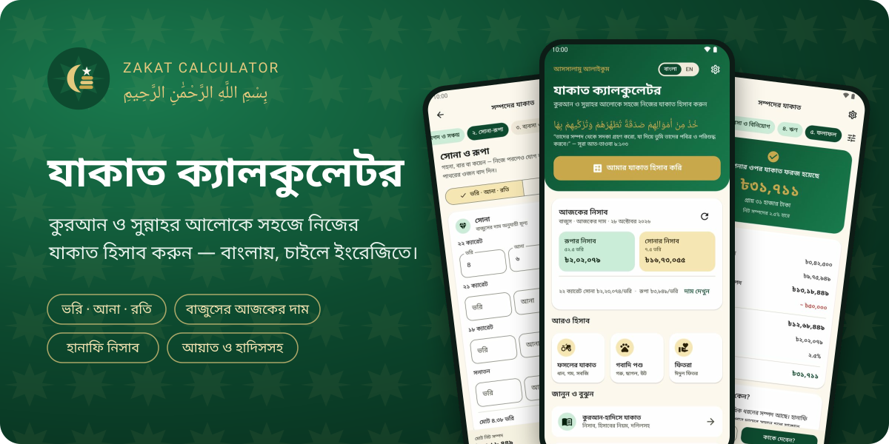
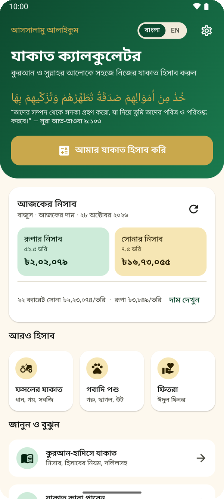
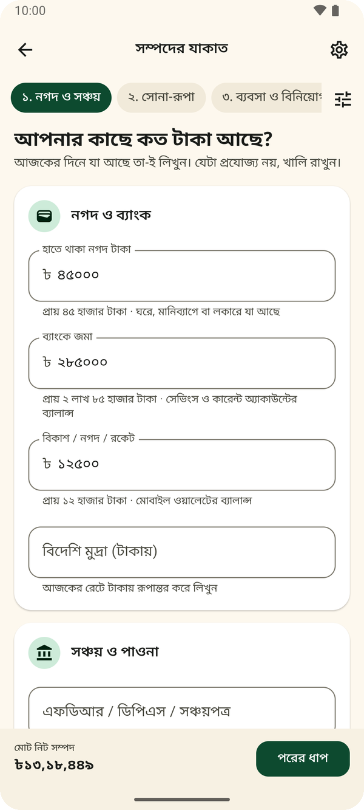
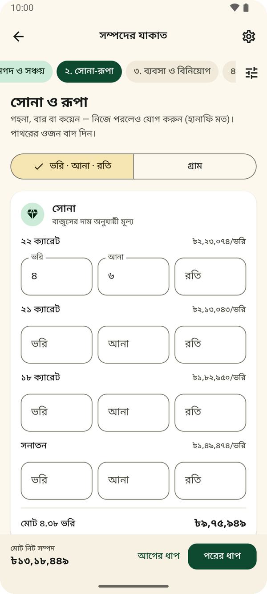
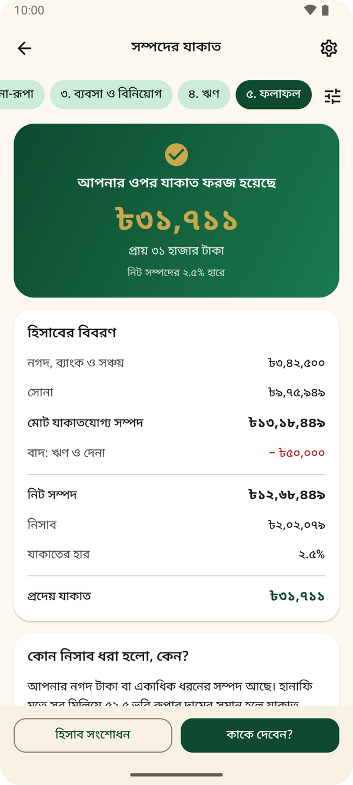
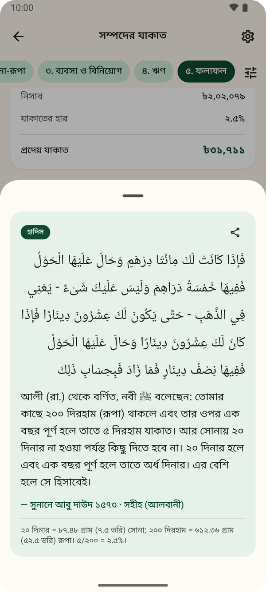
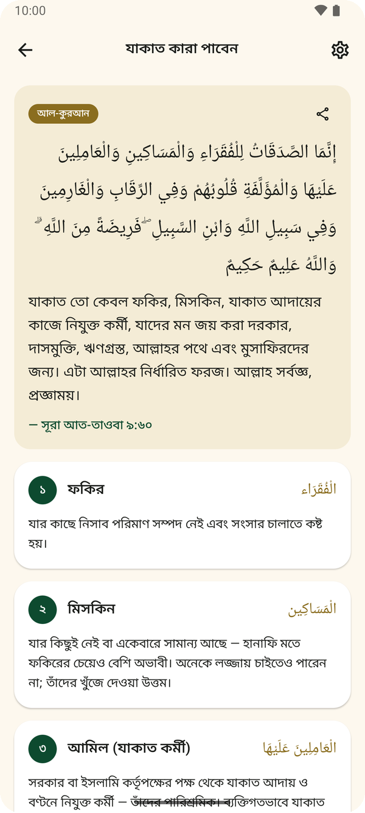
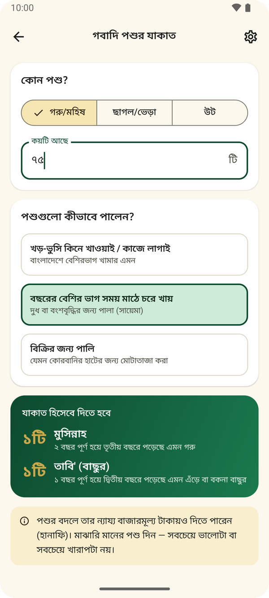
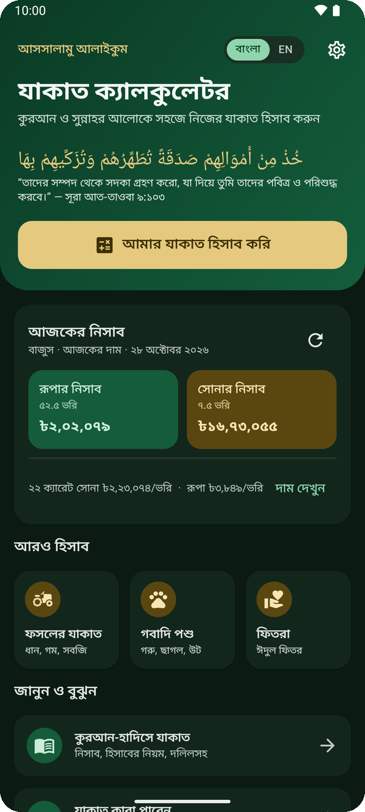
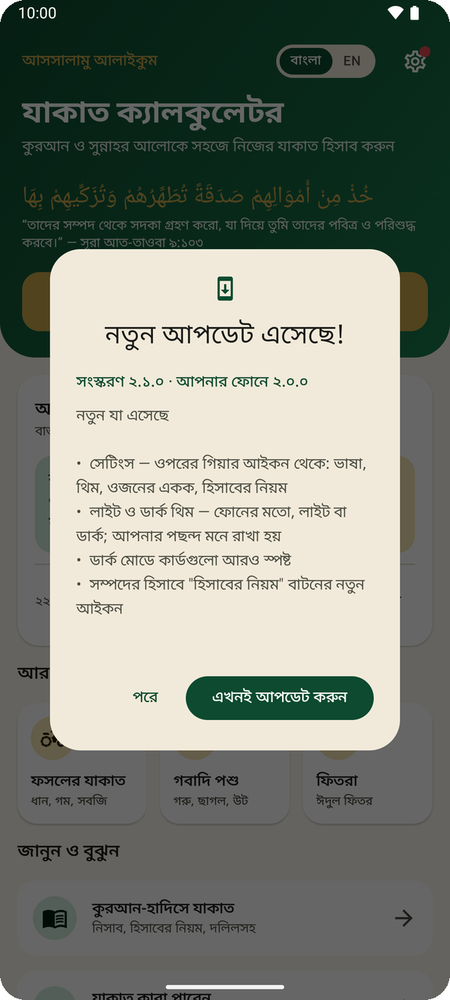

 

বিনামূল্যে · বিজ্ঞাপন নেই · অ্যান্ড্রয়েড ৮.০ বা নতুন · মাত্র ~১.৪ এমবি

  

   

**বাংলা** · [English](#english)

---

## যাকাত ক্যালকুলেটর কী?

কুরআন ও সুন্নাহর আলোকে বাংলাদেশের মানুষের জন্য তৈরি একটি সহজ যাকাত ক্যালকুলেটর। কত টাকা, কত ভরি সোনা আছে — ধাপে ধাপে লিখে দিন, অ্যাপ নিজেই বলে দেবে আপনার ওপর যাকাত ফরজ হয়েছে কি না, আর হলে কত টাকা দিতে হবে। প্রতিটি নিয়মের পাশে কুরআনের আয়াত ও হাদিস আছে, যাতে আপনি জেনে-বুঝে যাকাত দিতে পারেন।

## স্ক্রিনশট

<table>
  <tr>
    <td align="center"> <b>আজকের নিসাব এক নজরে</b></td>
    <td align="center"> <b>ধাপে ধাপে হিসাব</b></td>
    <td align="center"> <b>ভরি-আনা-রতিতে সোনা</b></td>
  </tr>
  <tr>
    <td align="center"> <b>পরিষ্কার ফলাফল ও বিবরণ</b></td>
    <td align="center"> <b>আরবি, অর্থ ও হাদিসের মান</b></td>
    <td align="center"> <b>যাকাতের ৮টি খাত</b></td>
  </tr>
  <tr>
    <td align="center"> <b>গবাদি পশুর যাকাত</b></td>
    <td align="center"> <b>ডার্ক মোড</b></td>
    <td align="center"> <b>অ্যাপের ভেতরেই আপডেট</b></td>
  </tr>
</table>

## যা যা পাবেন

| | |
|---|---|
| 🧮 **সম্পদের যাকাত** | নগদ টাকা, ব্যাংক, বিকাশ/নগদ/রকেট, সঞ্চয়পত্র-এফডিআর-ডিপিএস, ধার দেওয়া টাকা, ব্যবসার মাল, শেয়ার — পাঁচটি সহজ ধাপে |
| 🪙 **সোনা-রূপা** | ভরি-আনা-রতি বা গ্রামে; ২২, ২১, ১৮ ক্যারেট ও সনাতন — প্রতিটির আলাদা দাম |
| 📈 **বাজুসের আজকের দাম** | অ্যাপ খুললেই bajus.org থেকে দৈনিক দাম আসে; ইন্টারনেট না থাকলে সংরক্ষিত দাম |
| ⚖️ **হানাফি নিসাব** | শুধু সোনা থাকলে ৭.৫ ভরি, মিশ্র সম্পদে ৫২.৫ ভরি রূপার দাম — কোন নিসাব কেন ধরা হলো, তা-ও বলে দেয় |
| 💳 **ঋণ বাদ** | বকেয়া বিল, ব্যবসার দেনা, দীর্ঘমেয়াদি লোনের আগামী ১২ মাসের কিস্তি |
| 🌾 **ফসলের যাকাত (উশর)** | বৃষ্টির পানিতে ১০%, সেচে ৫%, মিশ্রে ৭.৫%; মণ বা কেজিতে |
| 🐄 **গবাদি পশু** | গরু-মহিষ, ছাগল-ভেড়া, উট — হাদিসের পূর্ণ তালিকা অনুযায়ী |
| 🍚 **ফিতরা** | ইসলামিক ফাউন্ডেশনের ২০২৬ সালের হার, পরিবারের সদস্যসংখ্যা অনুযায়ী |
| 📖 **কুরআন-হাদিস** | ৪০টির বেশি আয়াত ও হাদিস — মূল আরবি, বাংলা ও ইংরেজি অর্থ, হাদিসের মান (সহীহ/হাসান/দুর্বল) |
| ❓ **প্রশ্ন ও উত্তর** | গহনা, প্রভিডেন্ট ফান্ড, প্লট-ফ্ল্যাট, শেয়ার, সুদের টাকা, আগের বছরের বাকি যাকাত… |
| 🌙 **লাইট ও ডার্ক থিম** | ফোনের মতো, লাইট বা ডার্ক — সেটিংস থেকে |
| 🔄 **নিজে থেকে আপডেট** | নতুন সংস্করণ এলে অ্যাপেই জানিয়ে দেয়, এক ট্যাপে আপডেট |
| 🔒 **গোপনীয়তা** | আপনার সব তথ্য শুধু আপনার ফোনেই থাকে; কোনো অ্যাকাউন্ট বা বিজ্ঞাপন নেই |

## ইনস্টল করার নিয়ম

1. ওপরের **ডাউনলোড করুন** বোতাম চাপুন — `.apk` ফাইলটি ফোনে নেমে আসবে।
2. ডাউনলোড শেষ হলে ফাইলটি খুলুন।
3. ফোন "অজানা উৎস থেকে ইনস্টল" করার অনুমতি চাইলে **সেটিংস** থেকে অনুমতি দিন, তারপর ফিরে এসে **ইনস্টল** চাপুন।
4. ইনস্টল হয়ে গেলে "যাকাত ক্যালকুলেটর" খুলুন। ব্যস!

> **আপডেট:** একবার ইনস্টল করলে এরপর নতুন সংস্করণ এলে অ্যাপই আপনাকে জানাবে। তখন অ্যাপের ভেতর থেকেই আপডেট করা যাবে, আনইনস্টল করতে হবে না।
>
> **আগের ওয়েবভিউ সংস্করণ (v1) থাকলে:** নতুনটি ইনস্টলের আগে পুরোনোটি আনইনস্টল করে নিন।

## হিসাবের ভিত্তি

- **নিসাব:** সোনা ৮৭.৪৮ গ্রাম (৭.৫ ভরি), রূপা ৬১২.৩৬ গ্রাম (৫২.৫ ভরি) — সুনানে আবু দাউদ ১৫৭৩
- **হার:** হিজরি বছরে ২.৫%; ইংরেজি বছর ধরলে প্রায় ২.৫৭৭%
- **মাযহাব:** বাংলাদেশে প্রচলিত হানাফি মত প্রাধান্য পেয়েছে; ভিন্নমত থাকলে অ্যাপে উল্লেখ আছে
- **সূত্র:** কুরআনের আরবি পাঠ Tanzil থেকে; হাদিসের আরবি, নম্বর ও মান sunnah.com থেকে যাচাই করা

> ⚠️ এই অ্যাপ সাধারণ নির্দেশনার জন্য। যৌথ ব্যবসা, উত্তরাধিকার বা প্রতিষ্ঠানের যাকাতের মতো জটিল বিষয়ে একজন বিজ্ঞ মুফতির পরামর্শ নিন।

## সংস্করণের ইতিহাস

সব সংস্করণ ও কী কী বদলেছে, তা দেখুন [রিলিজ পাতায়](https://github.com/abdullah-al-faahim/zakat-calculator-app/releases)।

---

## English

Free · No ads · Android 8.0+ · ~1.4 MB

**Zakat Calculator** is a Bangla-first Android app for Bangladesh, guided by the Quran and Sunnah. Switch to English with one tap.

- **Step-by-step wealth calculator:** cash, bank, bKash/Nagad/Rocket, savings certificates, gold & silver, business stock, shares, minus debts.
- **Gold and silver in vori-ana-roti or grams**, by karat (22K, 21K, 18K, traditional), priced from **today's BAJUS rates** with an offline fallback.
- **Hanafi nisab rules**, explained: 7.5 tola if you own only gold, otherwise the value of 52.5 tola of silver.
- **Separate calculators** for crops (ushr), livestock (full hadith tables) and fitra (2026 Islamic Foundation rates).
- **40+ Quran verses and hadith** in Arabic with Bangla and English meanings and hadith grades, verified against Tanzil and sunnah.com.
- **Light and dark themes**, **in-app updates**, and **complete privacy**: everything stays on your phone.

**Install:** tap the download button, open the `.apk`, allow "install unknown apps" if Android asks, then install. Future updates arrive inside the app.

> ⚠️ For general guidance only. For complex cases, please consult a qualified mufti.

---

**রাব্বানা তাক্বাব্বাল মিন্না** — হে আমাদের রব, আমাদের পক্ষ থেকে কবুল করুন।

Made with care by **Abdullah Al Fahim**

